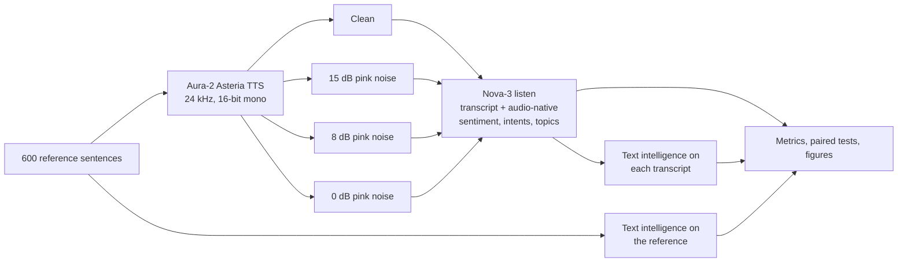
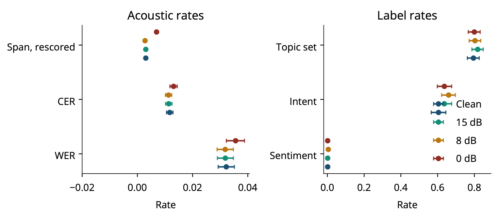
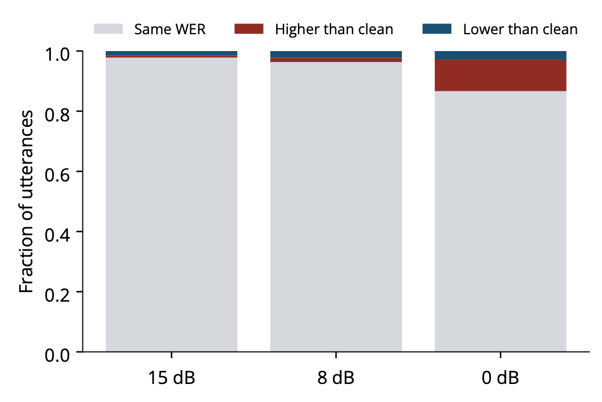
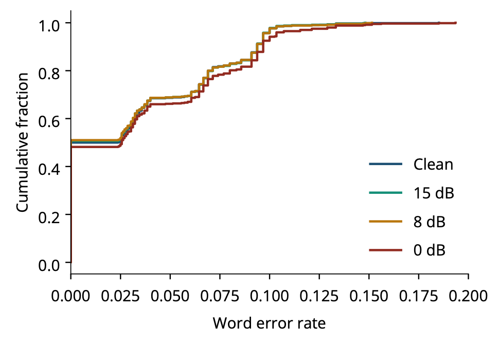
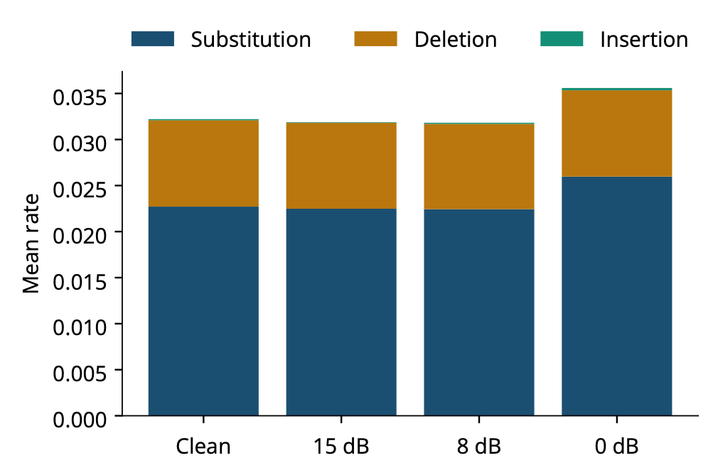
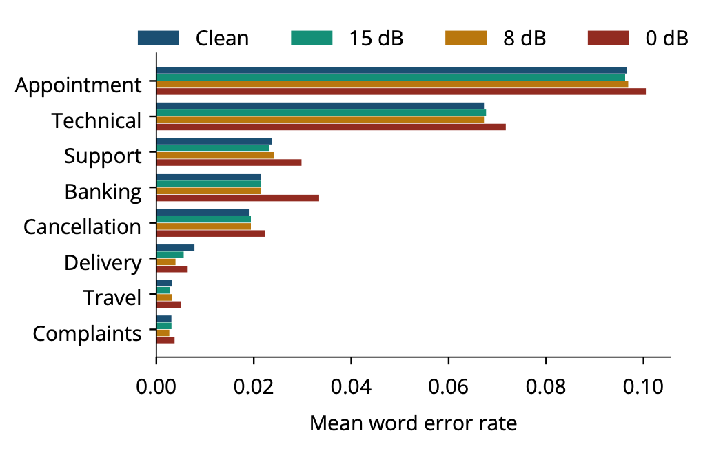
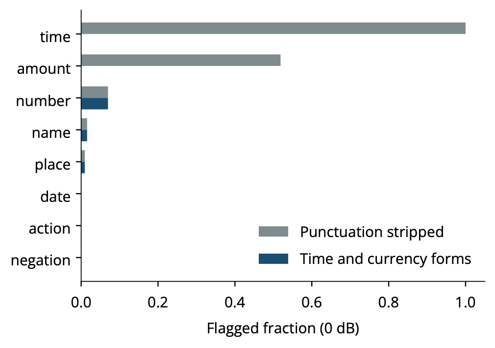
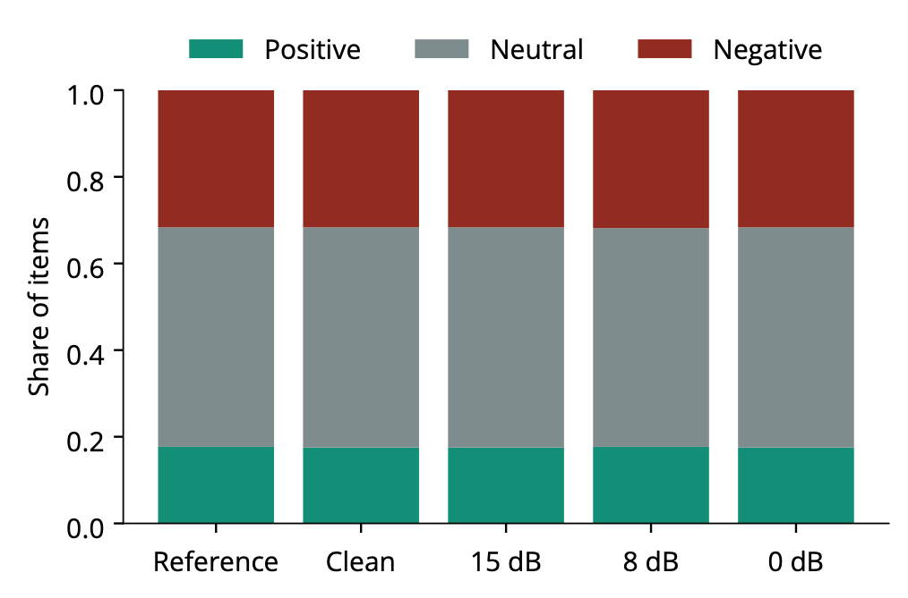
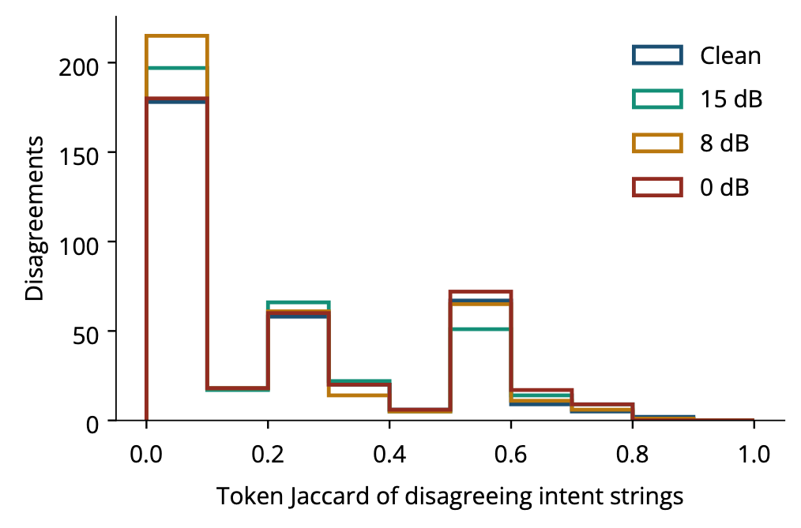
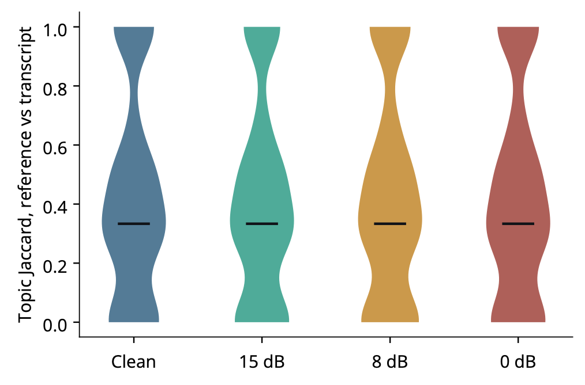

# The Speech-to-Insight Gap

**An end-to-end audit of acoustic error propagation in a commercial speech and text-intelligence API.**

Aditya Kumar, Indian Institute of Information Technology, Surat

Commercial speech APIs return more than words: they return sentiment, intent, and topics. This repository measures how far controlled acoustic degradation travels along one such path, Deepgram Aura-2 speech synthesis, then Nova-3 recognition, then Deepgram text intelligence, using the same 600 sentences at four noise levels.

**Headline result.** Pink noise down to 0 dB SNR raises paired word error by only 0.0034 and leaves sentiment unchanged. Intent and topic strings disagree on 60–66% and about 80% of items at *every* noise level, including on sentences whose transcript did not change. The large gap is in the open-label outputs, not in recognition.

---

## Contents

- [Study design](#study-design)
- [Results at a glance](#results-at-a-glance)
- [Results in depth](#results-in-depth)
  - [1. Transcription](#1-transcription)
  - [2. Critical spans](#2-critical-spans)
  - [3. Sentiment](#3-sentiment)
  - [4. Intent and topics](#4-intent-and-topics)
  - [5. Scenarios](#5-scenarios)
- [What the results mean](#what-the-results-mean)
- [Limitations](#limitations)
- [Repository layout](#repository-layout)
- [Reproducing the results](#reproducing-the-results)
- [Outputs](#outputs)
- [Cost](#cost)
- [Citation](#citation)

---

## Study design



| Item | Value |
|---|---|
| Reference sentences | 600 English customer-service sentences, 25–40 words (mean 30.4), 8 scenarios; 400 from templates, 200 paraphrases |
| Speech | Deepgram Aura-2 Asteria, 16-bit mono WAV at 24 kHz, about 99 minutes |
| Acoustic conditions | Clean, 15 dB, 8 dB, and 0 dB SNR generated pink noise (per-file seeds from a SHA-256 hash) |
| Recognition | Nova-3 `/v1/listen`, English, smart formatting, sentiment, intents, topics: 2,400 recordings |
| Text intelligence | `/v1/read` on the reference and on each of the four transcripts: 3,000 calls |
| Human relabeling | None. Author sentiment and intent tags are generation labels, not API labels |

Three comparisons separate where disagreement enters:

1. **Acoustic**: does the transcript change between clean and noisy audio?
2. **Transcription**: does text intelligence on the reference disagree with text intelligence on the transcript?
3. **Pipeline**: do labels read from the audio disagree with labels read from that recording's transcript?

### Metrics

- **Word and character error** after lowercasing, punctuation stripping, and whitespace collapsing (no number rewriting). Means carry a 95% bootstrap interval from 2,000 resamples at seed 42.
- **Paired acoustic differences** are computed per utterance. Two-sided Wilcoxon signed-rank tests use only utterances whose word error changed.
- **Critical spans** (names, places, dates, amounts, times, numbers, negations, actions) are flagged when the normalized form appears in only one of the reference and transcript. A rescored check also accepts spoken dollar amounts (`$250.00` vs `250`) and clock times with or without a leading zero (`9:30 AM` vs `0930am`).
- **Sentiment disagreement** is a mismatch among positive, negative, and neutral.
- **Intent disagreement** is an exact phrase mismatch after lowercasing and a three-entry synonym map; token Jaccard is reported on pairs that fail the exact match.
- **Topics** are compared as sets: whether the set changed, and its Jaccard overlap.

---

## Results at a glance



*Left: acoustic rates (word error, character error, rescored critical-span rate). Right: reference-versus-transcript label disagreement. Intervals are 95% bootstrap intervals.*

| Measure | Clean | 15 dB | 8 dB | 0 dB |
|---|---:|---:|---:|---:|
| Mean word error (95% CI) | 0.032 (0.029–0.035) | 0.032 (0.029–0.035) | 0.032 (0.029–0.035) | 0.036 (0.032–0.039) |
| Paired change vs clean (95% CI) | — | −0.0003 (−0.0008 to 0.0000) | −0.0004 (−0.0010 to 0.0002) | **+0.0034 (0.0021–0.0047)** |
| Wilcoxon on changed items | — | p = 0.12 (n = 13) | p = 0.33 (n = 22) | **p = 4.5 × 10⁻⁶ (n = 80)** |
| Exact transcripts | 50.0% | 50.7% | 51.0% | 48.2% |
| Word error > 0.10 | 2.3% | 2.2% | 2.3% | 5.8% |
| Mean character error | 0.012 | 0.011 | 0.011 | 0.013 |
| Critical-span rate, raw | 0.166 | 0.166 | 0.166 | 0.170 |
| Critical-span rate, rescored | 0.003 | 0.003 | 0.003 | 0.007 |
| Sentiment disagreement | 1/600 | 1/600 | 3/600 | 1/600 |
| Intent disagreement | 60.5% | 63.7% | 66.0% | 63.7% |
| Audio-native vs text-native intent | 62.7% | 64.3% | 64.5% | 61.8% |
| Topic set changed | 79.5% | 81.8% | 80.3% | 80.0% |
| Mean topic Jaccard | 0.421 | 0.406 | 0.415 | 0.421 |
| No topic in common | 24.8% | 26.5% | 27.2% | 25.5% |

---

## Results in depth

### 1. Transcription

The marginal word-error intervals overlap at every level, but the paired comparison does not. From clean to 15 dB and 8 dB, 97.8% and 96.3% of utterances keep exactly the same word error, and both paired intervals include zero. From clean to 0 dB the mean paired change is +0.0034: word error rises on 10.3% of utterances, falls on 3.0%, and is unchanged on 86.7%.

| Paired change | Word-error distribution |
|---|---|
|  |  |
| *Share of utterances whose word error is the same as, higher than, or lower than on clean speech.* | *Cumulative word-error distribution. The 0 dB curve leaves the others only in the right tail.* |

- Clean and 0 dB transcripts are identical for **495 of 600** sentences. The 105 that differ have mean 0 dB word error 0.064, against 0.030 on the rest.
- **Substitutions** carry the increase: 0.023 on clean audio and 0.026 at 0 dB. Deletions stay at 0.009 and insertions stay near 0.0002.
- Three 0 dB substitutions show what the mean averages over: "Austin" became "offer", "Taylor Brooks" became "Kayla Brooks", and "two times" became "at your time". Each changes a fact while costing one or two words of error.

| Error composition | Word error by scenario |
|---|---|
|  |  |
| *Substitutions, deletions, and insertions per condition.* | *Mean word error per scenario. The 0 dB mix does not reorder the scenarios.* |

### 2. Critical spans

The punctuation-stripped span rate (0.166–0.170) looks like one fact in six lost. It is almost entirely a formatting mismatch: Nova-3 smart formatting writes times and amounts differently from the reference. Once spoken forms are accepted, the rate drops to 0.003 on clean speech and 0.007 at 0 dB.



| Span type (0 dB) | Raw flagged | Rescored |
|---|---:|---:|
| Time | 169 / 169 | 0 / 169 |
| Amount | 97 / 187 | 0 / 187 |
| Number | 3 / 43 | 3 / 43 |
| Name | 4 / 259 | 4 / 259 |
| Place | 3 / 317 | 3 / 317 |
| Date | 0 / 256 | 0 / 256 |
| Negation | 0 / 152 | 0 / 152 |
| Action | 0 / 65 | 0 / 65 |

Thirty-nine negation spans are not literal substrings of the reference, so they cannot be scored as kept or lost.

### 3. Sentiment

Sentiment is the stable output.



*Sentiment mix on the reference text and on audio-native intelligence for each condition.*

- Reference-text sentiment is 50.7% neutral, 31.7% negative, 17.7% positive, and the audio-native mix stays in that band.
- Reference-versus-transcript disagreement is **1, 1, 3, and 1 of 600** items. The single clean flip is still the only flip at 0 dB; the two extra flips at 8 dB do not repeat at 0 dB.
- Audio-native and text-native sentiment disagree on **0 of 2,400** recordings. Clean and 0 dB audio sentiment differ for **0 of 600** utterances.
- Word error does not predict a flip: Spearman ρ = 0.032 (p = 0.115, n = 2,400).
- The author sentiment tag matches reference-text intelligence on 425 of 600 sentences (70.8%).

### 4. Intent and topics

Intent and topic strings change on most items at every level, and the noise is not what makes them change.

| Intent overlap | Topic Jaccard |
|---|---|
|  |  |
| *Token Jaccard of intent phrases that fail exact match.* | *Topic-set Jaccard between reference text and transcript (median 0.333).* |

- On the **495 sentences whose 0 dB transcript equals the clean transcript**, intent disagreement is already 61.6% and the topic set still changes 78.6% of the time. On the 105 whose transcript changes, those rates are 73.3% and 86.7%.
- Intent pairs that fail exact match have mean token Jaccard of about 0.19, 0.18, 0.17, and 0.21 (clean, 15 dB, 8 dB, 0 dB), and 48.8%, 51.3%, 54.3%, and 47.1% share no word at all.
- The reference text emits 233 distinct intent phrases; clean audio emits 245. The author intent tag matches the reference-text phrase on only 131 of 600 sentences (21.8%).
- The synonym map sends "cancel order" and "cancel my order" to `cancellation`, and "book appointment" and "schedule appointment" to `scheduling`.

### 5. Scenarios

Scenario moves word error far more than noise does: the clean-speech range across scenarios is 0.003–0.097, while the largest clean-to-0 dB change in any scenario is 0.012 (banking). Intent disagreement also tracks scenario, not noise.

| Scenario (n) | WER clean | WER 15 dB | WER 8 dB | WER 0 dB | Intent clean | Intent 15 dB | Intent 8 dB | Intent 0 dB |
|---|---:|---:|---:|---:|---:|---:|---:|---:|
| Appointment (96) | 0.097 | 0.096 | 0.097 | 0.100 | 0.396 | 0.479 | 0.510 | 0.490 |
| Technical (73) | 0.067 | 0.068 | 0.067 | 0.072 | 0.822 | 0.863 | 0.877 | 0.932 |
| Support (79) | 0.024 | 0.023 | 0.024 | 0.030 | 0.709 | 0.848 | 0.772 | 0.772 |
| Banking (43) | 0.021 | 0.021 | 0.021 | 0.033 | 0.744 | 0.814 | 0.884 | 0.744 |
| Cancellation (65) | 0.019 | 0.019 | 0.019 | 0.022 | 0.046 | 0.077 | 0.077 | 0.031 |
| Delivery (77) | 0.008 | 0.006 | 0.004 | 0.006 | 0.831 | 0.805 | 0.870 | 0.844 |
| Travel (83) | 0.003 | 0.003 | 0.003 | 0.005 | 0.434 | 0.422 | 0.422 | 0.434 |
| Complaints (84) | 0.003 | 0.003 | 0.003 | 0.004 | 0.881 | 0.821 | 0.917 | 0.845 |

Cancellations, which often map to the closed label `cancellation`, stay at 3–8% intent disagreement. Technical and complaint calls sit at 82–93% while their word error is as low as 0.003.

---

## What the results mean

1. **Report paired differences, not marginal ones.** The marginal intervals at clean and 0 dB overlap, yet the paired interval excludes zero. Comparing condition means alone would call 0 dB harmless.
2. **Span metrics need spoken forms.** Without normalizing times and currency, a span metric measures smart formatting, not recognition (0.17 raw against 0.003 rescored).
3. **Open labels need a stability baseline.** Most of the intent and topic gap exists before any acoustic change. Before attributing a label change to noise, measure how often the label changes when the words do not.
4. **Sentiment transfers.** In this configuration, sentiment can be read from the audio interface without loss relative to the text interface.

## Limitations

- One synthetic voice and generated pink noise; a recorded environment, reverberation, or a second voice could move word error further.
- Sentences come from templates and paraphrases, not real calls.
- Intent and topic scores are string comparisons, not human ratings of the caller's goal.
- Each input was sent once, so run-to-run variation of text intelligence on identical text was not measured.
- Findings are specific to Aura-2 Asteria, Nova-3, and these text-intelligence settings.

---

## Repository layout

```
config/experiment.yaml     Study sizes, SNR levels, models, budget caps
src/
  cli.py                   Entry point for every stage
  generate_dataset.py      600 reference sentences (templates + paraphrases)
  validate_dataset.py      Length, uniqueness, and span checks
  deepgram_tts.py          Aura-2 synthesis, WAV header repair, retries
  perturb_audio.py         Pink-noise mixing at 15, 8, and 0 dB SNR
  validate_audio.py        Format and per-condition difference checks
  deepgram_listen.py       Nova-3 /v1/listen through a worker pool
  deepgram_read.py         /v1/read on references and transcripts
  request_pool.py          Bounded concurrent requests with a stop gate
  cache.py                 Atomic JSON writes, resumable cached responses
  parse_responses.py       Transcript and intelligence tables
  calculate_wer.py         Word and character error
  calculate_critical_errors.py, span_rescore.py   Raw and relaxed span checks
  calculate_disagreement.py                       Label comparisons
  statistical_analysis.py  Bootstrap intervals, Spearman, summaries
  extended_analysis.py     Paired tests, span types, overlap, figures 4–12
  generate_paper_assets.py Tables and core figures
  write_findings.py        Machine-written findings notes
  budget.py, budget_estimator.py                  Spend tracking and preflight
tests/                     Unit tests (parsing, metrics, spans, pool, audio)
assets/figures/            PNG copies of the result figures shown above
data/, results/, figures/, tables/   Generated locally (git-ignored)
```

## Reproducing the results

```bash
python3 -m venv .venv
source .venv/bin/activate
pip install -r requirements.txt
cp .env.example .env      # add DEEPGRAM_API_KEY (and OPENROUTER_API_KEY for paraphrases)
pytest                    # 21 tests
```

The default config runs in dry-run mode, which writes placeholder responses and makes no API calls:

```bash
python -m src.cli run-pilot --dry-run
python -m src.cli paper-assets
```

The full live study, followed by every table and figure:

```bash
python -m src.cli run-full --live --validate
python -m src.cli paper-assets
```

Individual stages: `generate-dataset`, `validate-dataset`, `tts`, `perturb`, `validate-audio`, `listen`, `read`, `metrics`, `stats`, `paper-assets`, `preflight-cost`, `run-pilot`, `run-full`, `validate-results`. All accept `--config`, `--no-resume`, and `--max-requests`; `--live` calls Deepgram. Saved responses are reused on resume, so an interrupted run continues without re-billing finished requests. Seeds are fixed in `config/experiment.yaml`.

## Outputs

| Path | Contents |
|---|---|
| `data/references.jsonl` | The 600 reference sentences with scenario, tags, and annotated spans |
| `data/audio/` | Clean and noisy waveforms plus perturbation metadata and seeds |
| `results/raw_responses/` | 600 TTS, 2,400 listen, and 3,000 read responses |
| `results/transcripts.csv` | 2,400 transcripts |
| `results/intelligence.csv` | 5,400 normalized sentiment, intent, and topic rows |
| `results/metrics.csv` | 2,400 rows of per-utterance, per-condition metrics |
| `results/summary.json` | Bootstrap intervals and per-condition and per-scenario rates |
| `results/extended_summary.json` | Paired tests, rescored spans, intent-overlap counts |
| `results/cost_report.json` | Spend estimates and preflight |
| `figures/`, `tables/` | Figures (PDF) and LaTeX tables |

## Cost

Synthesis and recognition are estimated at **$3.45** from published per-character and per-minute rates (synthesis $2.90, recognition $0.55) over 4,377 requests. Text intelligence has no public unit price in the tracker, so that line is recorded as zero; this is not evidence that the calls were free.

## Citation

```bibtex
@misc{kumar2026speechinsightcode,
  title        = {The Speech-to-Insight Gap: Code and Pipeline for an End-to-End Audit of Acoustic Error Propagation in a Commercial Speech API},
  author       = {Kumar, Aditya},
  year         = {2026},
  howpublished = {GitHub repository},
  url          = {https://github.com/addygeek/The-Speech-to-Insight-Gap-An-End-to-End-Audit-of-Acoustic-Error-Propagation-in-a-Commercial-Speech}
}
```
